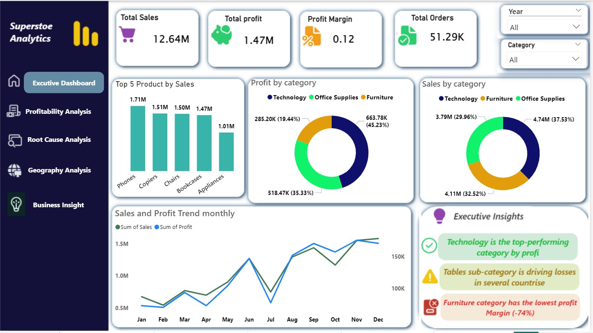
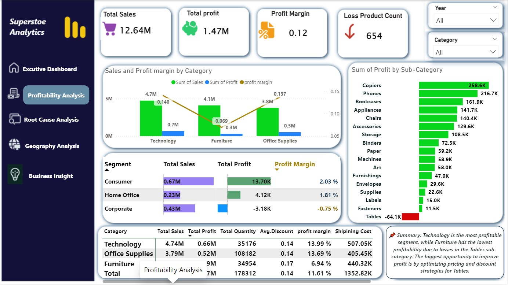
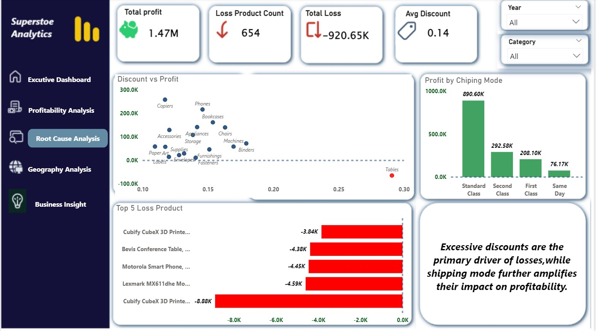
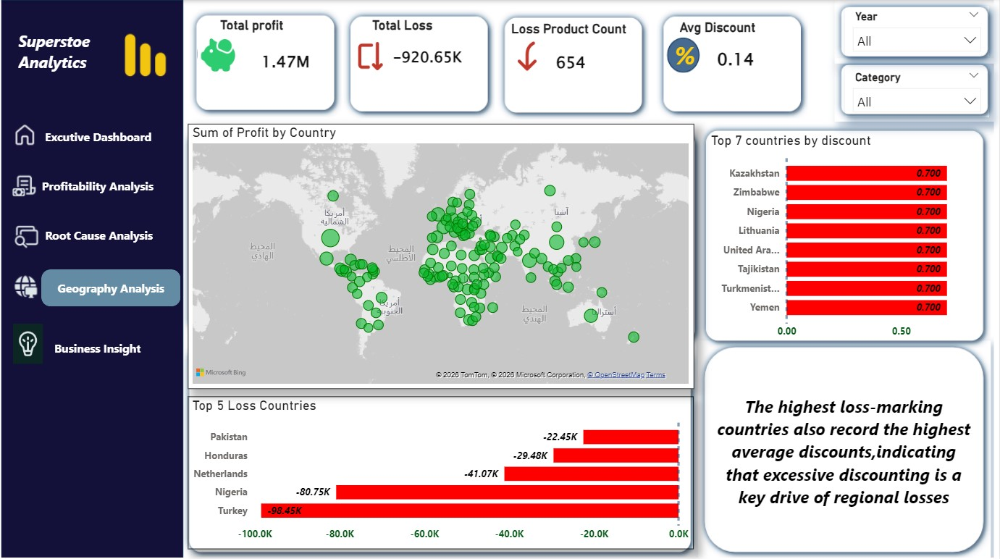
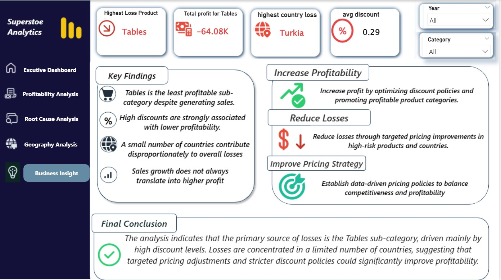

<div align="center">

# Global Superstore
## Sales & Profitability Analytics

**An End-to-End Business Intelligence Project | Microsoft Power BI**

[](https://powerbi.microsoft.com/)
[](https://learn.microsoft.com/en-us/power-query/)
[](https://learn.microsoft.com/en-us/dax/)
[](#dataset-at-a-glance)

*Turning transactional data into clear performance insights and better business decisions.*

</div>

---

## Table of Contents

- [Project Overview](#project-overview)
- [Business Questions](#business-questions)
- [Dataset at a Glance](#dataset-at-a-glance)
- [Technology Stack](#technology-stack)
- [Analytics Workflow](#analytics-workflow)
- [Data Model](#data-model)
- [Dashboard Experience](#dashboard-experience)
- [Key Metrics](#key-metrics)
- [Key Findings](#key-findings)
- [Business Recommendations](#business-recommendations)
- [Repository Structure](#repository-structure)
- [Run the Project](#run-the-project)

---

## Project Overview

The **Global Superstore Sales & Profitability Analytics** project is an interactive Business Intelligence solution built with **Microsoft Power BI**. It analyzes global retail transactions across products, customers, markets, and time to understand what drives revenue and, more importantly, what drives profit.

The project combines data preparation, dimensional modeling, DAX calculations, interactive reporting, and root cause analysis. Its goal is to move beyond high-level sales reporting and uncover where the business performs well, where profitability is under pressure, and which areas deserve management attention.

> **Core business question:** Which products, customer segments, and markets create sustainable profit — and where is revenue failing to translate into profitability?

## Business Questions

This analysis is designed to answer the following questions:

1. How are sales and profit performing over time?
2. Which product categories and sub-categories contribute most to revenue and profit?
3. Which products generate losses despite contributing to sales?
4. How are discounts associated with changes in profitability?
5. Which countries and markets have the weakest profit performance?
6. How do shipping costs and shipping modes affect business profitability?
7. What actions can management prioritize to improve profit performance?

## Dataset at a Glance

| Attribute | Description |
|---|---|
| Dataset | Global Superstore |
| Records | **51,290 rows** |
| Columns | **24 fields** |
| Period | **2011–2014** |
| Granularity | Order-line / product-line level |
| Coverage | Orders, customers, products, geography, sales, discounts, shipping, and profit |

### Data Domains

| Domain | Representative Fields |
|---|---|
| Orders | `Row ID`, `Order ID`, `Order Date`, `Ship Date`, `Ship Mode`, `Order Priority` |
| Customers | `Customer ID`, `Customer Name`, `Segment` |
| Products | `Product ID`, `Product Name`, `Category`, `Sub-Category` |
| Geography | `City`, `State`, `Country`, `Postal Code`, `Market`, `Region` |
| Measures | `Sales`, `Quantity`, `Discount`, `Profit`, `Shipping Cost` |

## Technology Stack

| Technology | Role in the Project |
|---|---|
| **Microsoft Power BI** | Interactive dashboards, reporting, and data exploration |
| **Power Query** | Data cleaning, transformation, and ETL |
| **DAX** | KPI calculations and analytical measures |
| **Star Schema** | Structured dimensional data modeling |
| **Data Visualization** | Trend analysis, comparisons, and performance monitoring |
| **Business Intelligence** | Translating analysis into business insights |
| **Root Cause Analysis** | Investigating loss-making products and markets |

## Analytics Workflow

The project follows a structured analytics workflow:

1. **Understand the data** — review the dataset structure, business fields, and transaction-level granularity.
2. **Prepare the data** — inspect data types, missing values, duplicates, and numeric fields in Power Query.
3. **Build the model** — organize the data using a fact table and supporting dimensions.
4. **Create analytical measures** — develop DAX measures for sales, profit, margin, orders, discounts, and shipping costs.
5. **Explore performance** — analyze results by time, category, sub-category, customer segment, shipping mode, and geography.
6. **Investigate root causes** — examine discount and shipping patterns associated with weak or negative profitability.
7. **Communicate findings** — present the results through five connected report pages and business recommendations.

## Data Model

The report uses a **Star Schema** centered on `Fact_Sales`, supported by four dimension tables.

| Table | Purpose | Example Attributes |
|---|---|---|
| `Fact_Sales` | Stores transactional sales and financial values | Order ID, Date Key, Customer Key, Product Key, Geography Key, Sales, Profit, Quantity, Discount, Shipping Cost |
| `Dim_Date` | Enables time-based analysis | Date, Year, Quarter, Month |
| `Dim_Customer` | Enables customer and segment analysis | Customer ID, Customer Name, Segment |
| `Dim_Product` | Enables product analysis | Product ID, Product Name, Category, Sub-Category |
| `Dim_Geography` | Enables location-based analysis | Country, Market, Region, State, City |

The dimension tables provide descriptive context for filtering and grouping the sales fact table. The model supports consistent analysis across time, customers, products, and geographic markets.

## Dashboard Experience

The Power BI report is organized into five pages. Each page addresses a distinct analytical purpose, from executive monitoring to detailed investigation.

### 1. Executive Overview

<p align="center">
  
</p>

A high-level view of business performance, bringing together key financial KPIs, sales trends, and product/category comparisons.

**Analytical focus:** Total Sales, Total Profit, Profit Margin, Orders, product performance, category performance, and time trends.

### 2. Profitability Analysis

<p align="center">
  
</p>

A deeper comparison of revenue and profit across categories, sub-categories, and customer segments.

**Analytical focus:** Profit contribution, margin performance, category comparisons, and segment-level results.

### 3. Root Cause Analysis

<p align="center">
  
</p>

An investigation of factors associated with low or negative profit, including discount patterns, shipping modes, and product-level performance.

**Analytical focus:** Discount vs. profit, shipping mode performance, and loss-making products.

### 4. Geographic Analysis

<p align="center">
  
</p>

A geographic view of sales and profitability to identify markets and countries with strong or weak financial performance.

**Analytical focus:** Profit by country and market, geographic loss patterns, and discount distribution.

### 5. Business Insights

<p align="center">
  
</p>

A consolidated view of the most important findings and their implications for business performance.

**Analytical focus:** Profit improvement opportunities, loss reduction, discount management, and market-level investigation.

## Key Metrics

The report uses financial and operational KPIs to measure business performance.

| KPI | Business Definition |
|---|---|
| **Total Sales** | Sum of recorded sales |
| **Total Profit** | Sum of recorded profit |
| **Profit Margin** | Total Profit ÷ Total Sales |
| **Orders Count** | Distinct count of Order ID |
| **Total Quantity** | Total units sold |
| **Total Shipping Cost** | Sum of shipping costs |
| **Average Discount** | Average discount across transaction rows |

### Core DAX Measures

```dax
Total Sales =
SUM(Fact_Sales[Sales])
```

```dax
Total Profit =
SUM(Fact_Sales[Profit])
```

```dax
Profit Margin =
DIVIDE([Total Profit], [Total Sales], 0)
```

```dax
Orders Count =
DISTINCTCOUNT(Fact_Sales[Order ID])
```

```dax
Total Shipping Cost =
SUM(Fact_Sales[Shipping Cost])
```

```dax
Average Discount =
AVERAGE(Fact_Sales[Discount])
```

## Key Findings

The analysis highlights several important patterns in the Global Superstore business:

### Overall Performance

| Metric | Result |
|---|---:|
| Total Sales | **$12.64M** |
| Total Profit | **$1.47M** |
| Profit Margin | **11.61%** |
| Distinct Orders | **25,035** |
| Total Quantity | **178,312** |
| Total Shipping Cost | **$1.35M** |
| Average Discount | **14.29%** |

### Category and Product Performance

- **Technology** is the strongest category by total profit, contributing approximately **$663.78K**.
- **Furniture** contributes approximately **$285.20K** in profit and shows comparatively weaker profitability.
- **Tables** is a major loss-making sub-category, with approximately **-$64.08K** in total profit.

### Geographic Profitability

The following countries are among the markets with the largest recorded losses:

| Country | Total Profit |
|---|---:|
| Turkey | **-$98.45K** |
| Nigeria | **-$80.75K** |
| Netherlands | **-$41.07K** |
| Honduras | **-$29.48K** |
| Pakistan | **-$22.45K** |

### Discounts and Shipping

- Discount levels are examined alongside profit to understand how promotional activity relates to profitability.
- Shipping costs are compared across products, categories, countries, and shipping modes to identify areas requiring closer review.

## Business Recommendations

Based on the observed performance patterns, the analysis points to the following priorities:

1. **Review Tables profitability:** investigate the products and markets contributing most to the sub-category's losses.
2. **Strengthen discount governance:** evaluate promotions using profit and margin, not sales volume alone.
3. **Investigate loss-making markets:** review product mix, discounting, and fulfillment economics in the countries with the largest losses.
4. **Monitor shipping economics:** compare shipping costs across shipping modes, products, and markets.
5. **Track revenue and profitability together:** assess commercial performance using sales, profit, and margin as complementary measures.

## Repository Structure

```text
Superstore-Sales-Profit-Analytics/
│
├── dashboard/
│   └── super1.pbix
│
├── data/
│   └── Global_Superstore2.csv
│
├── images/
│   ├── 1.jpg
│   ├── 2.jpg
│   ├── 3.jpg
│   ├── 4.jpg
│   └── 6.jpg
│
└── README.md
```

## Run the Project

1. Clone or download this repository.
2. Open `dashboard/super1.pbix` using **Microsoft Power BI Desktop**.
3. If Power BI requests the source file, connect it to `data/Global_Superstore2.csv`.
4. Refresh the data.
5. Explore the five report pages using the available filters and visual interactions.

---

<div align="center">

**Global Superstore — Sales & Profitability Analytics**

*From transactional data to actionable business intelligence.*

</div>
