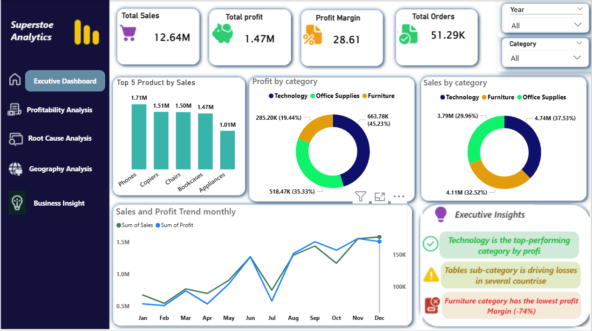
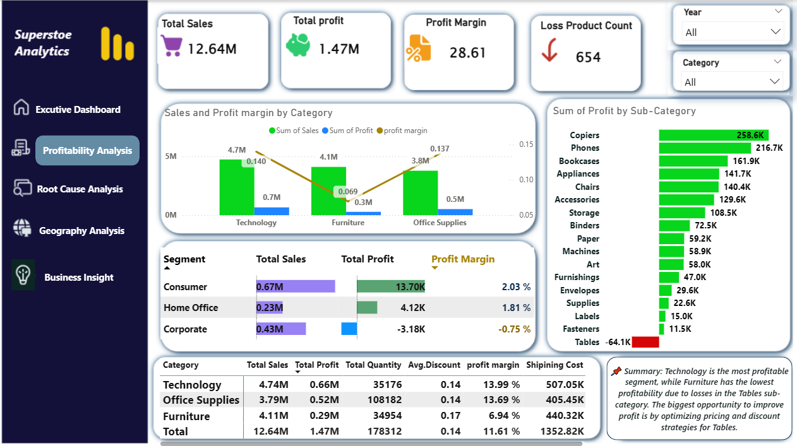
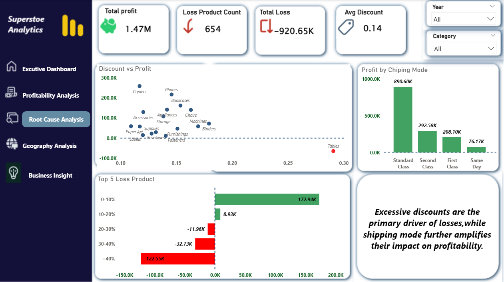
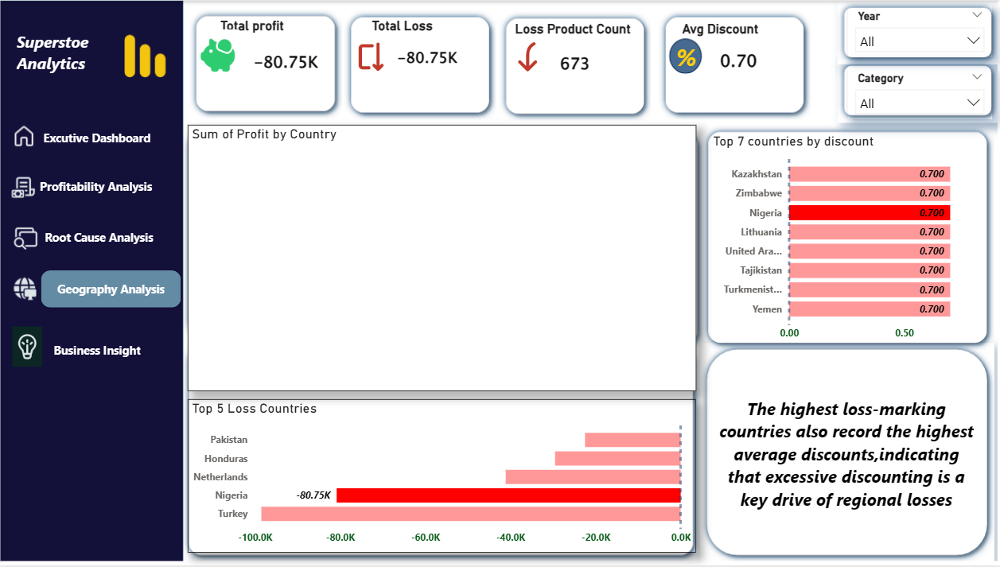
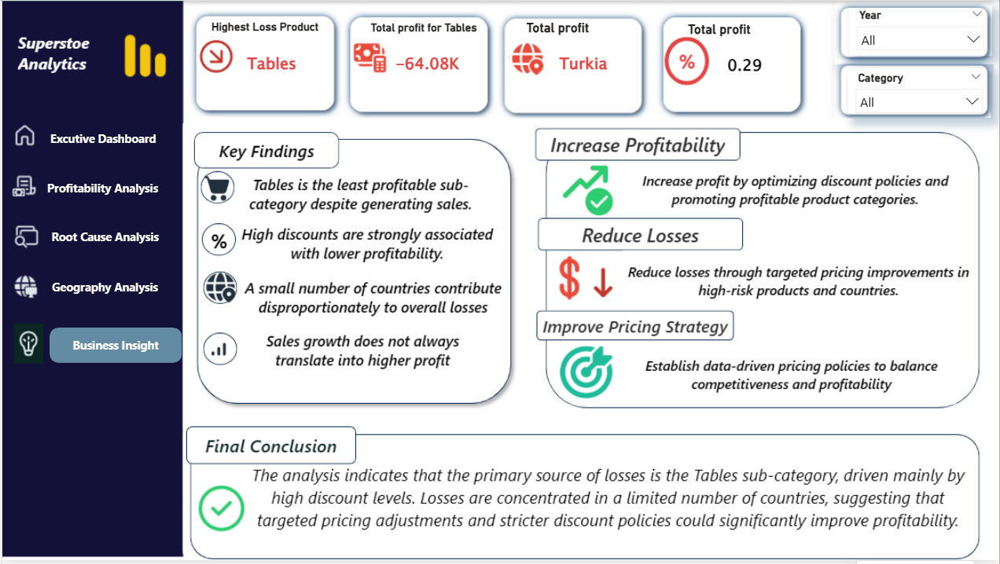

# Superstore Sales & Profit Analysis

An exploratory business-intelligence project using the Global Superstore dataset. The project includes a Power BI report and dashboard screenshots for reviewing sales performance, profitability, product categories, discount patterns, geography, and business insights.

## Project Contents

- `dashboard/super1.pbix` — Power BI report file.
- `data/Global_Superstore2.csv` — CSV version of the dataset.
- `data/Global_Superstore2.xlsx` — Excel version of the same dataset.
- `images/` — screenshots of the report pages.

## Tools

- Microsoft Power BI
- Microsoft Excel / CSV data

> Only list additional tools (such as Power Query, DAX, Python, or SQL) if you actually used them in this project.

## Dataset Overview

The supplied dataset contains **51,290 rows and 24 columns**, including order and shipping dates, customer and product attributes, geographic fields, sales, quantity, discount, profit, and shipping cost. The dataset spans order years 2011–2014.

## Questions Explored

- How do sales and profit vary by product category and sub-category?
- Which products or sub-categories contribute to losses?
- How do discounts relate to profitability?
- How does performance vary across regions and countries?
- What trends and business recommendations can be identified from the report?

## Initial Findings from the Provided CSV

These figures were recalculated from the CSV included in this repository and represent the full dataset, without dashboard filters:

- **Total sales:** 12.64M
- **Total profit:** 1.47M
- **Overall profit margin (total profit ÷ total sales):** 11.61%
- **Total quantity sold:** 178,312
- **Most profitable category by total profit:** Technology (approximately 663.78K)
- **Lowest-profit category by total profit:** Furniture (approximately 285.20K)
- **Loss-making sub-category:** Tables (approximately -64.08K profit)

Values are rounded for readability. They may differ from a visual when filters are active.

## Business Recommendations to Validate

- Investigate the Tables sub-category to understand the products, markets, and discount levels associated with losses.
- Review discounting rules and assess profitability alongside sales volume before increasing discounts.
- Compare performance by category and geography before deciding where to focus promotions or operational improvements.

These are starting points for investigation, not causal conclusions. Validate them against the report's filters and underlying calculations before using them in a business decision.

## Important Validation Notes

Before presenting this project publicly, review the following items in Power BI:

1. The screenshot KPI labelled **Profit Margin = 28.61** appears to match the dataset's **average profit per row** (about 28.61), not the overall profit margin. The overall margin calculated as total profit divided by total sales is about **11.61%**. If the card is intended to show margin, correct the measure or label.
2. Some supplied screenshots show different values for loss-product counts, total loss, and average discount. Check whether these differences are intentional filter states or inconsistent measures, and ensure each page is clearly labelled.
3. One screenshot appears to contain a blank chart area. Check that visual and its data/filters in Power BI before publishing the screenshots.
4. Confirm that the PBIX opens correctly and that its data-source paths work on another computer. Prefer relative project paths or explain how to reconnect the dataset if necessary.

## How to View

Open `dashboard/super1.pbix` in Microsoft Power BI Desktop. If Power BI asks for a data source, reconnect it to the included CSV or Excel file and refresh the report.

## Screenshots

### Executive Dashboard

### Profitability Analysis

### Root Cause Analysis

### Geographical Analysis

### Business Insights

## Notes

This is a portfolio project for analytical demonstration. The findings are based on the supplied dataset and should be checked against the Power BI report before being used in a real business context.
